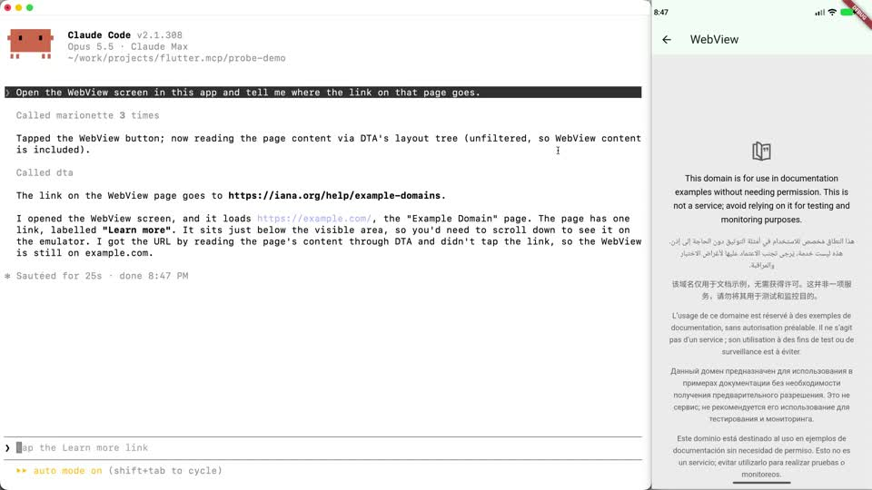
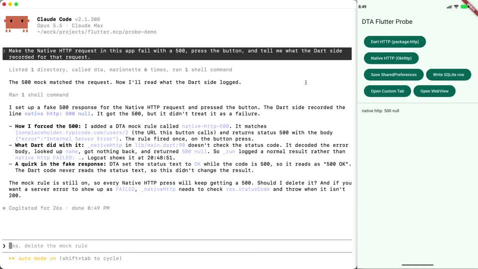
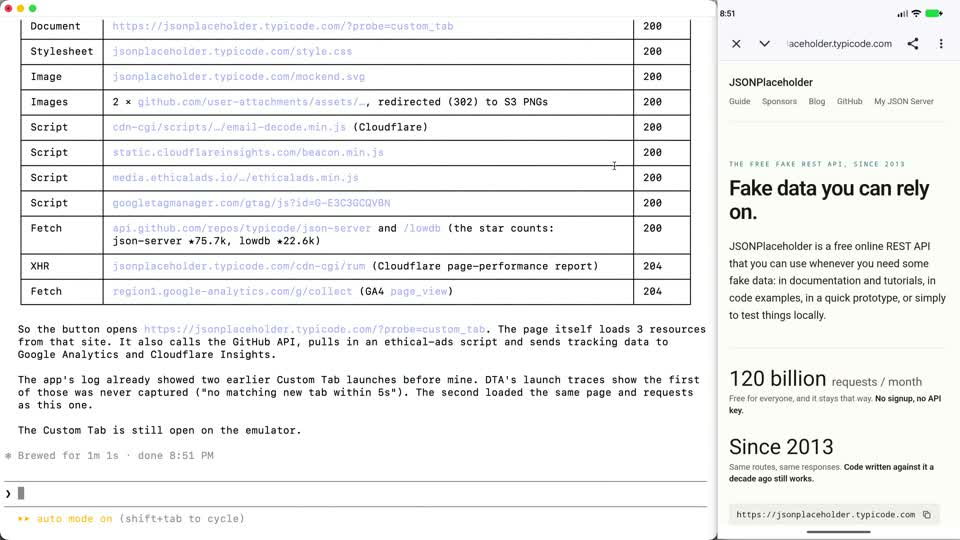

# dta_flutter_probe

A Flutter app on Android is really two apps in one: the Dart code you write, and
the native Android app it runs inside. WebViews, Custom Tabs, plugin storage and
native networking all happen on the native side. Can a coding agent see what's
going on there, and change it?

This repo is a small Flutter app that uses both sides, plus three short videos of
Claude Code working on it with three MCP servers connected:

- the [Dart & Flutter MCP server](https://github.com/dart-lang/ai/tree/main/pkgs/dart_mcp_server), for the Dart side
- [Marionette](https://github.com/leancodepl/marionette_mcp), to tap through the Flutter UI
- [DTA](https://github.com/yamsergey/dta), which runs inside the Android app and reads and changes the native side

## The videos

The agent is on the left and the app on the right. The prompts say what to find
out, not which tool to use. Waits where only the spinner moves are sped up.

### 1. What's inside a WebView

The app shows a web page in a WebView. Asked where the link on that page goes, the
agent opens the screen with Marionette, then reads the page with DTA, link target
included, without tapping anything. The Flutter tools see only the back button and
the title.

[](videos/webview.mp4)

### 2. Making the backend fail on purpose

The agent makes the app's native HTTP request return a 500, then presses the
button. The app carries on as if nothing went wrong, and the agent finds out why:
the code never checks the status code. A bug that normally needs a broken server,
reproduced on demand.

[](videos/mock500.mp4)

### 3. A Custom Tab

Login pages often open in a Custom Tab, which runs in Chrome, not in the app. The
agent reads what's on the page and lists every request it made.

[](videos/customtab.mp4)

One note on the WebView video: the agent's project notes say that DTA's
`layout_tree` shows the page only when called without filters. With a `type:
"WebView"` filter, the current DTA release leaves the page out.

## Why this matters

Reading the app is half of it. The other half is changing it: mocking a backend
response, putting a stale token back, seeding a database, so a bug happens on
demand instead of once a day. Coding agents make that kind of custom debugging
environment practical for mobile developers, as long as they can reach both sides
of the app.

DTA is Android-only. The same in-app approach works on iOS:
[FLEX](https://github.com/FLEXTool/FLEX) has long shown that network traffic, files
and user defaults can be inspected and edited from inside an iOS app. It just isn't
exposed to agents.

## What each server can see

The Dart side is well covered by the Flutter tools. The native side is almost
invisible to them. The one exception is `ok_http`, which reports its requests into
Dart's HTTP profile through `package:http_profile`.

| What the agent needs to know | Dart & Flutter MCP | Marionette | DTA |
|---|---|---|---|
| Which widgets are on screen | ✅ | ✅ with keys, tappable | ❌ one `FlutterView` |
| What Dart's HTTP client sent and received | ✅ after profiling is enabled | ❌ | ❌ |
| What OkHttp (`ok_http`) sent and received | ✅ via `package:http_profile` | ❌ | ✅ recorded from launch |
| What's inside the WebView | ❌ | ❌ | ✅ full DOM with bounds |
| Whether a Custom Tab is open, and its traffic | ❌ | ❌ | ✅ |
| What's stored in SharedPreferences and SQLite | ❌ | only via a custom extension | ✅ |
| Make the backend fail on demand | ❌ | ❌ | ✅ mock rules on OkHttp |
| Which code created an element | partly: one widget at a time, after a tap in selection mode | ❌ | ❌ for Flutter widgets |

When DTA mocked the 500, Dart's HTTP profiler recorded it as a genuine server
response. Only DTA knows it was mocked.

## What's in the app

One screen with a button per path through the app, plus a WebView screen:

| Button (widget key) | What it does | Layer |
|---|---|---|
| Dart HTTP (`dart_http`) | `package:http` GET `/users/1` | Dart (`dart:io` sockets) |
| Native HTTP (`native_http`) | `ok_http` GET `/users/2` | Android (OkHttp) |
| Save SharedPreferences (`prefs`) | `shared_preferences`: `auth_token`, `user_role` | Android SharedPreferences |
| Write SQLite row (`sqlite`) | `sqflite`: `probe.db`, table `profile` | Android SQLite |
| Open Custom Tab (`custom_tab`) | `url_launcher`, `LaunchMode.inAppBrowserView` | Chrome's process |
| Open WebView (`webview`) | `webview_flutter`, loads example.com | Android WebView (platform view) |

It also registers a Marionette extension, `probe.expireToken`, which replaces the
stored token with an expired one.

## Reproducing it

### Tested with

| | Version |
|---|---|
| Flutter / Dart | 3.47.7 / 3.13.5 |
| Dart & Flutter MCP server | 1.2.0 (bundled with Dart) |
| Marionette MCP | 0.7.0 |
| DTA | 0.9.40 |
| Device | Android emulator, API 37 (October 2026) |

### Prerequisites

- Flutter 3.47+ (Dart 3.9+ for `dart mcp-server`)
- An Android emulator or device. API 28+ for all of DTA's features.
- Marionette: `dart pub global activate marionette_mcp`
- DTA: `brew tap yamsergey/packages && brew install dta-cli`, or the DTA plugin
  for Android Studio

### Run the app

```sh
flutter run -d <device> --print-dtd
```

Note the VM service URI and the DTD URI it prints, then export them for the
scripts:

```sh
export VM_SERVICE_WS=ws://127.0.0.1:<port>/<token>=/ws   # VM service URI, http → ws, plus /ws
export DTD_URI=ws://127.0.0.1:<port>/<token>=
```

`ISOLATE_ID` comes from the `getVM` call in `02-dart-mcp-enable-http-profile.json`
(the `main` isolate).

The debug build already includes the DTA sidekick (see
`android/app/build.gradle.kts`). With the DTA Android Studio plugin or
`dta-cli run`, it's injected automatically and that dependency can be removed.

### Run the scenarios

`scripts/mcp_batch.py` sends a list of tool calls to an MCP server over stdio and
prints the results. Each file in `scripts/calls/` is one scenario:

```sh
cd scripts
MARIONETTE="dart pub global run marionette_mcp"
python3 mcp_batch.py calls/01-marionette-exercise-app.json 2000 -- $MARIONETTE
python3 mcp_batch.py calls/02-dart-mcp-enable-http-profile.json 2000 -- dart mcp-server
python3 mcp_batch.py calls/04-dta-native-side.json 3000 -- dta-cli mcp serve
```

| Calls file | Server | Shows |
|---|---|---|
| `01-marionette-exercise-app.json` | Marionette | Presses every button by key; calls the `probe.expireToken` extension |
| `02-dart-mcp-enable-http-profile.json` | Dart MCP | Finds the isolate; turns on Dart's HTTP profiling |
| `03-dart-mcp-read-http-profile.json` | Dart MCP | Dart's HTTP profile: `dart:io` and `ok_http` entries (`from_package/N`) |
| `04-dta-native-side.json` | DTA | OkHttp traffic, SharedPreferences, SQLite rows, lifecycle |
| `05-dta-mock-500.json` | DTA | Mocks `/users/2` with a 500. Press Native HTTP again, then rerun `03` |
| `06-marionette-webview.json` | Marionette | Opens the WebView; only the back button and title are visible |
| `07-dta-layout-tree.json` | DTA | On the WebView screen: the page's DOM inside the platform view |
| `08-marionette-custom-tab.json` | Marionette | Opens the Custom Tab; still lists the Flutter buttons behind it |
| `09-dta-custom-tab-traffic.json` | DTA | The tab's attach trace and traffic |
| `10-dart-mcp-widget-locations.json` | Dart MCP | `get_widget_tree` without locations; the raw inspector call with `fullDetails` returns `creationLocation` |

Delete the mock rule afterwards with `mock_delete_rule`.

## Selected outputs

The WebView screen, as Marionette sees it:

```
Found 2 interactive element(s):
Type: BackButton
Type: Text, Text: "WebView"
```

The same screen, from DTA's `layout_tree`:

```
FlutterView
 └ PlatformViewWrapper
    └ WebViewPlatformView
       └ web "Example Domain"
          ├ web "This domain is for use in documentation examples…"
          └ web "Learn more"
```

The mocked request, in Dart's HTTP profile (`getHttpProfileRequest`):

```
id: from_package/2   uri: .../users/2   status: 500
body: {"name":"MOCKED BY DTA"}   connectionInfo: package:ok_http / OkHttpClient
```

The same request, in DTA:

```
url: .../users/2   responseCode: 500   mocked: true   mockRuleId: 254e6aac-…   source: OkHttp
```

## Two notes on the Dart & Flutter MCP server

- `get_widget_tree` sends `fullDetails: 'false'` to
  `ext.flutter.inspector.getRootWidgetTree` (hard-coded in
  `lib/src/mixins/dtd.dart`), which drops each widget's `creationLocation`. The
  same call with `fullDetails: 'true'` returns, for example,
  `main.dart:179:19` for each `FilledButton`. Today `get_selected_widget` is the
  only way to get a location: one widget at a time, after a tap in selection mode.
- Apps can register `ext.*` service extensions and the server can call them
  through `vm_service`, but `getIsolate` lists only their names. Marionette's
  `registerMarionetteExtension` with an `inputSchema` shows how such extensions
  can become described, named MCP tools.

## Build notes

- `ok_http` depends on `jni`, whose Android module compiles against API 31.
  `android/build.gradle.kts` raises `compileSdk` for plugin modules to 36.
- `OkHttpClient.close()` evicts the connection pool on the Android main thread
  and throws `NetworkOnMainThreadException`, so the app keeps one long-lived
  client.
- On Android 11+, `url_launcher` needs the `<queries>` entries in
  `AndroidManifest.xml` to find a Custom Tabs browser.
